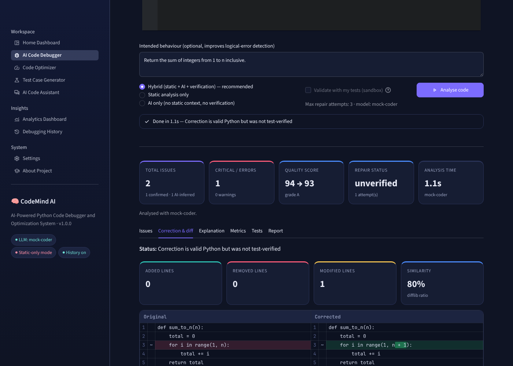

# 🧠 CodeMind AI – AI-Powered Python Code Debugger and Optimization System

> B.Tech AI & ML final-year major project · Python · Streamlit · Ollama (local LLM) · fully offline · no paid APIs

CodeMind AI is a **hybrid, self-verifying debugging framework** for Python. It combines deterministic static
analysis (AST, symtable, Pylint, Radon) with a locally hosted coding LLM (Qwen2.5-Coder via Ollama), and it
checks every AI correction before trusting it: schema validation → syntax revalidation → static re-analysis →
optional tests in an isolated Docker sandbox → a bounded repair loop.


<sub>Screenshot taken with the bundled *mock* Ollama server (canned answers), not a real model.</sub>

## ✨ Features

| Area | What it does |
|---|---|
| **Code editor** | Syntax-highlighted editor with line numbers and inline issue markers, `.py` upload, 12 sample buggy programs, clear/reset, optional "intended behaviour" field |
| **Bug detection** | Syntax & indentation errors, undefined variables, missing imports, type hazards, potential runtime exceptions, unreachable code, unused variables, bad practices; line numbers, categories, severities; **confirmed** (static) vs **AI-inferred** findings |
| **AI correction** | Structured JSON from a local LLM (findings, corrected code, change list, explanation, assumptions), tolerant parsing, retries, hallucinated-line filtering, interface-preservation check |
| **Optimizer** | Measured metrics (Radon), rule-based AST suggestions, heuristic Big-O, and clearly-labelled AI estimates |
| **Comparison** | Side-by-side diff with green/red highlights and character-level changes, counts, copy and download |
| **Tests** | LLM-proposed candidate tests (normal/edge/boundary/invalid) in an editable table → pytest file; independent benchmark tests kept separate |
| **Secure validation** | Docker sandbox: no network, non-root, CPU/memory/PID limits, read-only FS, timeout, output limits; static-only mode when unavailable |
| **Dashboard & analytics** | Quality score (documented formula), complexity, MI, test results, before/after radar, stage timings, history trends, benchmark charts |
| **AI assistant** | Chat about the current code with analysis context |
| **History** | SQLite with search, status/date filters, details, reload, delete, delete-all, and a switch to disable storage |
| **Reports** | PDF and JSON reports incl. limitations and recommendations |
| **Research evaluation** | 122-example verified dataset, three-way comparison script, CSV/JSON results, charts |

## 🚀 Quick start

```bash
# 1. Python 3.11+ and a virtual environment
python -m venv .venv
# Windows: .venv\Scripts\activate      macOS/Linux: source .venv/bin/activate
pip install -r requirements.txt

# 2. Local LLM (optional but recommended) – https://ollama.com/download
ollama pull qwen2.5-coder:1.5b

# 3. Optional: isolated test execution (needs Docker Desktop / Docker Engine)
docker build -t codemind-sandbox:latest sandbox/

# 4. Run
streamlit run app.py
```

Without Ollama the app runs in **static-analysis mode**; without Docker it **never executes code**.
Full beginner-friendly steps, model choices and troubleshooting: [docs/installation.md](docs/installation.md).

## 🧪 Tests and benchmark

```bash
python check_setup.py                    # checks packages, database, Ollama (one real AI fix) and Docker
pytest                                   # unit + integration tests (Docker tests auto-skip if no sandbox image)
python run_benchmark.py --limit 10       # trial run on 10 programs (saved as a trial, not as main results)
python run_benchmark.py                  # main run: static vs LLM-only vs hybrid on the eval split, plus charts
python run_benchmark.py --resume         # continue an interrupted run
```

**Measured so far** (eval split, 92 buggy + 92 clean programs, Python 3.13, Pylint on):

| Method | Accuracy | Precision | Recall | F1 | FPR | Repair rate |
|---|---|---|---|---|---|---|
| Static analysis (Baseline 1) | 0.690 | 1.000 | 0.380 | 0.551 | 0.000 | n/a (no repair) |
| LLM only (Baseline 2) | *not yet run* | | | | | |
| Hybrid (proposed) | *not yet run* | | | | | |

The LLM-based methods need a machine with Ollama; they have **not** been evaluated yet. See
[PROJECT_STATUS.md](PROJECT_STATUS.md) and [docs/methodology.md](docs/methodology.md).

## 🏗️ Architecture


Layers are separated: `views/` (UI only) → `core/` (logic, AI, validation) → `database/` → `utils/`.
More diagrams (DFD, UML, ER, sequence): [docs/architecture.md](docs/architecture.md).

## 📁 Project structure

```
app.py  config.py  requirements.txt  Dockerfile  .env.example  PROJECT_STATUS.md
views/      dashboard, debugger, optimizer, test_generator, ai_assistant, analytics, history, settings, about, components
core/       syntax_checker, static_analyzer, complexity_analyzer, llm_engine, ai_debugger, optimizer,
            test_generator, test_validator, sandbox, code_comparator
database/   connection, models, operations
utils/      validators (Pydantic schemas), prompts, logger, helpers, report_generator
sandbox/    Dockerfile, runner.py           datasets/   sample_bugs.json, benchmark.json, builders, README.md (sources, licences)
evaluation/ benchmark_runner, metrics, visualization, results/
tests/      unit tests, conftest (scripted LLM), mock_ollama_server.py
docs/       synopsis, SRS, architecture, methodology, user manual, developer guide, report, paper, slides, viva …
```

## 📚 Documentation

[Installation](docs/installation.md) · [User manual](docs/user_manual.md) · [Developer guide](docs/developer_guide.md) ·
[Architecture](docs/architecture.md) · [Methodology](docs/methodology.md) · [SRS](docs/SRS.md) ·
[Synopsis](docs/synopsis.md) · [Project report](docs/project_report.md) · [Research paper draft](docs/research_paper.md) ·
[Presentation](docs/presentation.md) · [Viva Q&A](docs/viva_questions.md) · [Testing report](docs/testing_report.md) ·
[Demo script](docs/demo_script.md) · [Resume description](docs/resume_description.md)

## ⚠️ Limitations

- Small local models can miss bugs or propose wrong fixes; all AI output is labelled and should be reviewed.
- Static analysis alone cannot find most logical errors (measured recall on logical bugs: 0.0).
- Passing tests is evidence, not proof, of correctness.
- Heuristic Big-O and AI complexity values are estimates, not measurements.

## License

MIT – see [LICENSE](LICENSE). QuixBugs (if downloaded with `datasets/prepare_quixbugs.py`) is MIT-licensed by its authors.
