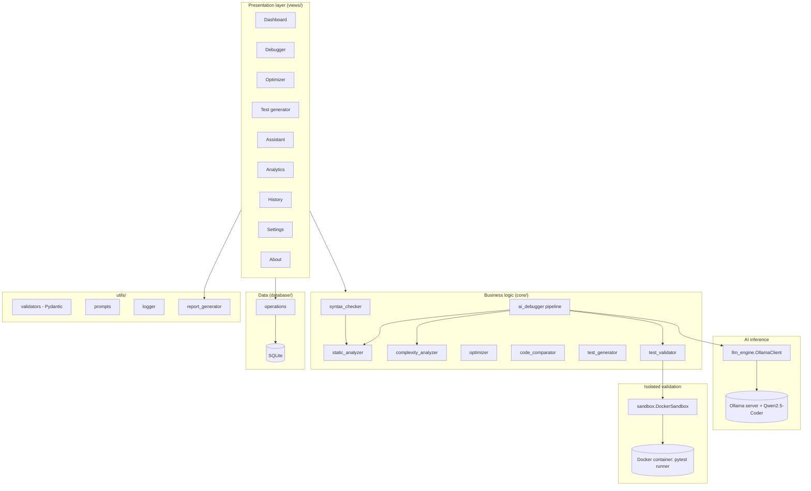
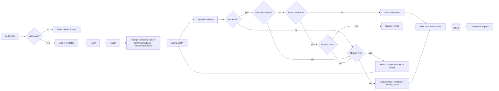
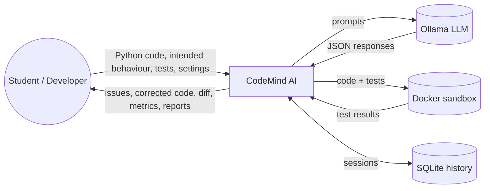
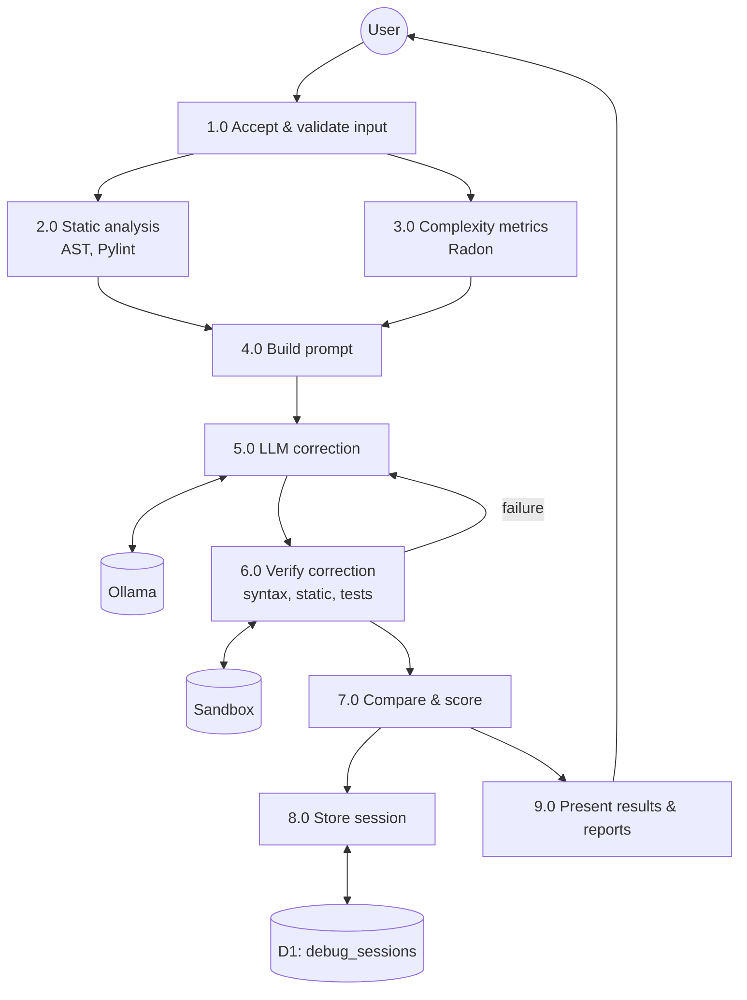
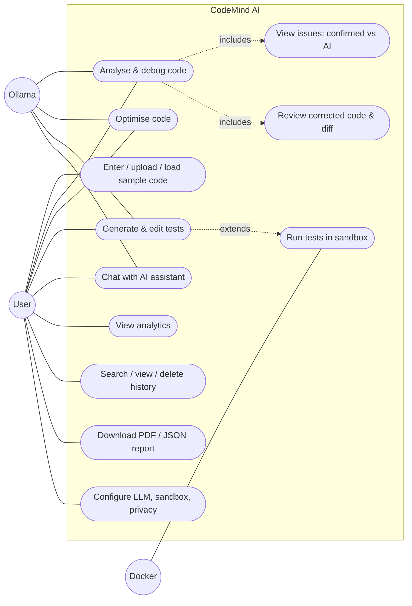
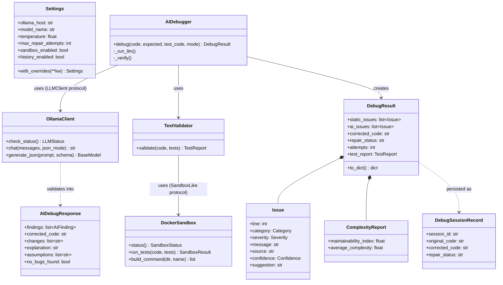
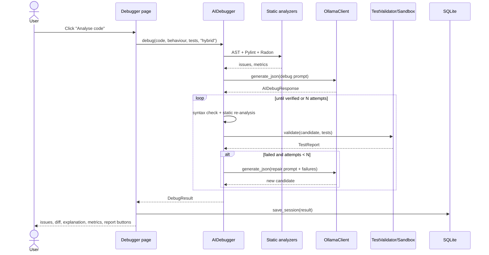
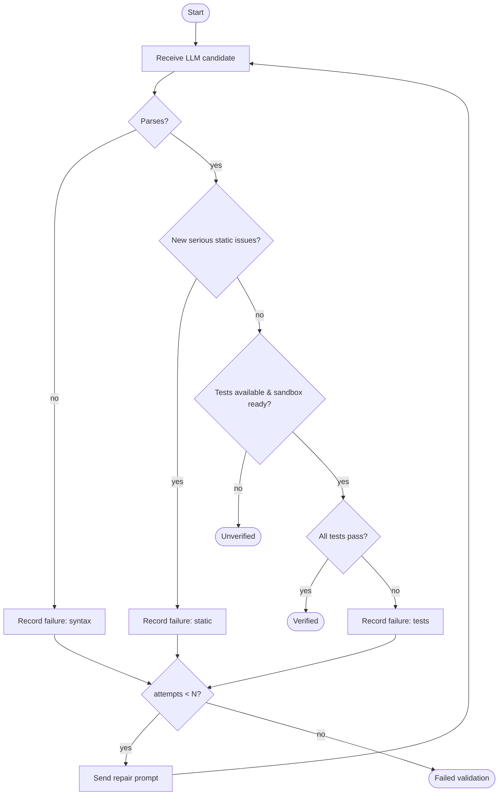
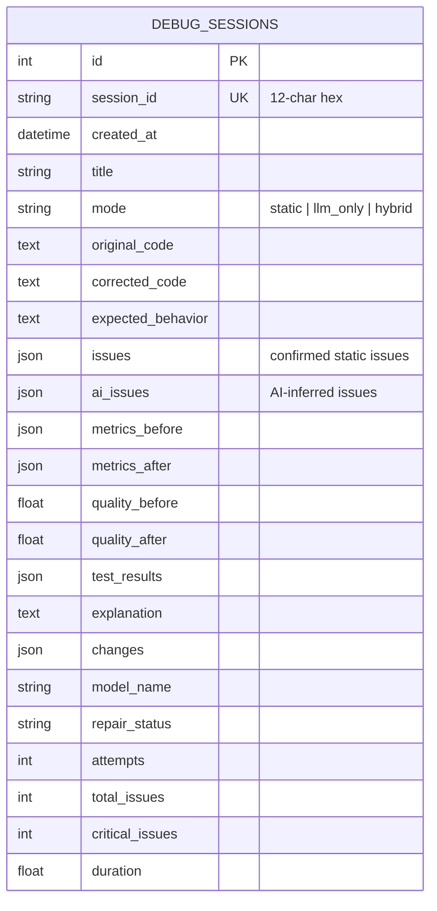

# System Architecture and Design Diagrams

All diagrams use Mermaid (rendered by GitHub, VS Code "Markdown Preview Mermaid Support", or <https://mermaid.live>).

## 1. Layered architecture

**Key decisions**
- *Single pipeline, three modes.* `AIDebugger.debug(mode=...)` implements Baseline 1 (`static`), Baseline 2
  (`llm_only`) and the proposed method (`hybrid`), so the evaluation compares like with like.
- *Protocols for external systems.* The debugger depends on an `LLMClient` protocol and a `SandboxLike` protocol,
  so tests inject a scripted LLM and a fake sandbox; no network or Docker is needed for unit tests.
- *Confirmed vs AI-inferred.* Every `Issue` carries `source` (ast / pylint / llm) and `confidence`
  (confirmed / heuristic / ai_inferred). The UI and reports never mix them.
- *Fail safe.* Ollama offline → static mode; Docker missing → no execution; malformed JSON → re-ask, then fall back.

## 2. Pipeline (proposed hybrid method)

## 3. Data Flow Diagram – Level 0 (context)

## 4. Data Flow Diagram – Level 1

## 5. UML use case diagram

## 6. UML class diagram (core types)

## 7. Sequence diagram – "Analyse code" (hybrid mode)

## 8. Activity diagram – repair loop

## 9. ER diagram and database schema

A single denormalised table is deliberate: each session is written once and read as a whole; JSON columns keep the
schema stable while issue/metric structures evolve. Indexes: `session_id` (unique), `created_at`, `repair_status`.

## 10. Module responsibilities

| Module | Responsibility |
|---|---|
| `core/syntax_checker.py` | Parse; syntax/indentation errors; symtable-based undefined names, missing imports, unused locals; unreachable code; bad-practice patterns |
| `core/static_analyzer.py` | Pylint subprocess (`--from-stdin`, temp dir, timeout), message mapping, de-duplicated merge |
| `core/complexity_analyzer.py` | Radon raw/CC/MI/Halstead; quality score formula; grade |
| `core/llm_engine.py` | Ollama health check, chat, JSON mode, retries/backoff, tolerant JSON extraction |
| `core/ai_debugger.py` | Pipeline orchestration, modes, repair loop, AI finding filtering, interface check |
| `core/optimizer.py` | Rule-based patterns, heuristic Big-O, measured warnings, optional AI suggestions |
| `core/code_comparator.py` | difflib side-by-side rows, counts, inline character highlights, unified diff |
| `core/test_generator.py` | LLM tests → `TestCaseSpec`, expression safety filter, pytest rendering |
| `core/test_validator.py` | Pre-checks, calls sandbox, normalises outcome, disclaimer |
| `core/sandbox.py` | Hardened `docker run`, status checks, image build, output parsing |
| `database/*` | Engine/session scope, ORM model, CRUD + statistics |
| `utils/report_generator.py` | JSON & PDF reports with limitations and recommendations |
