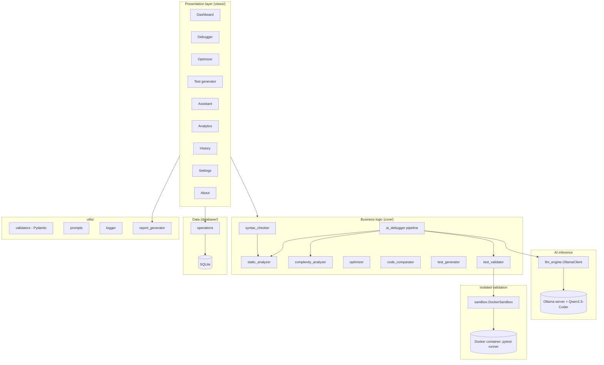
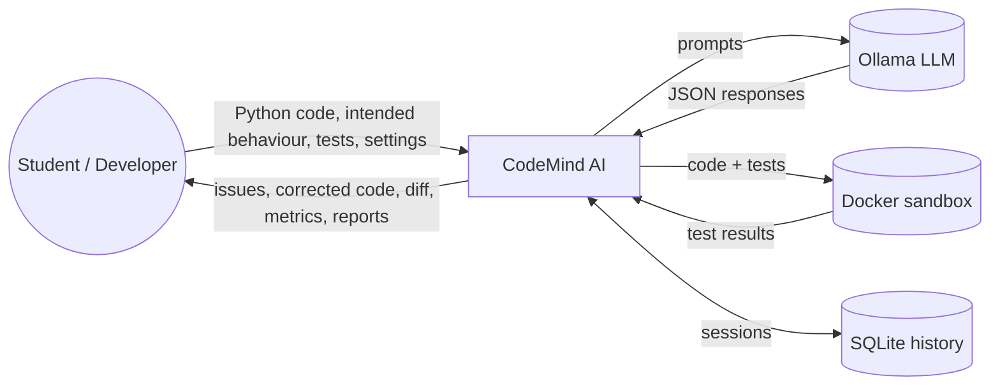
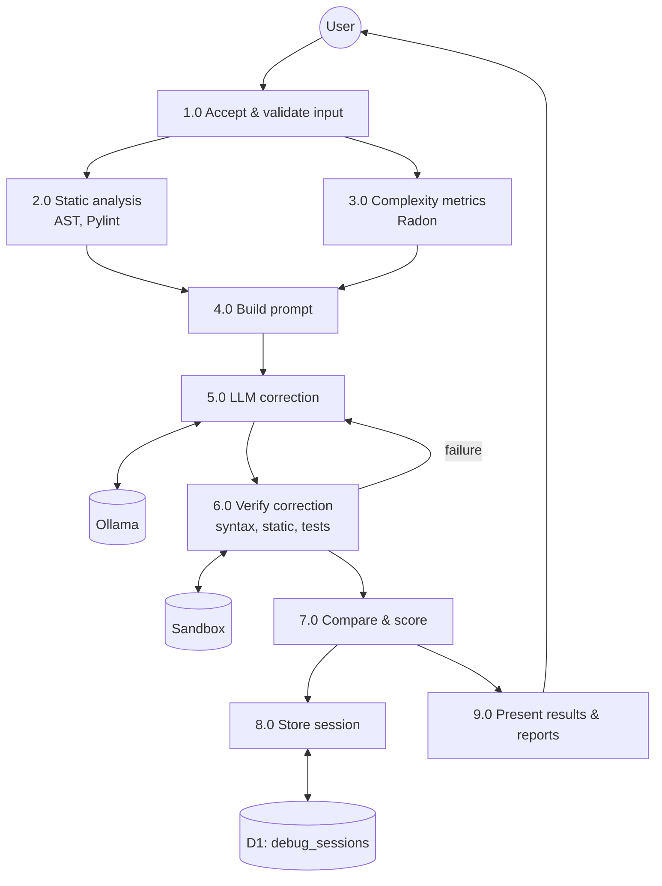
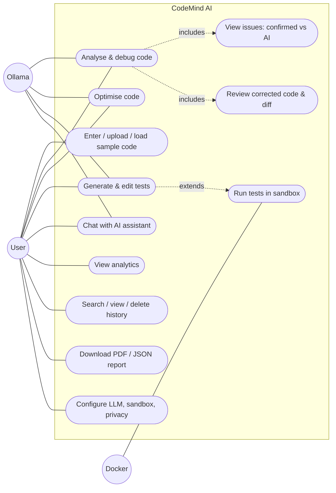
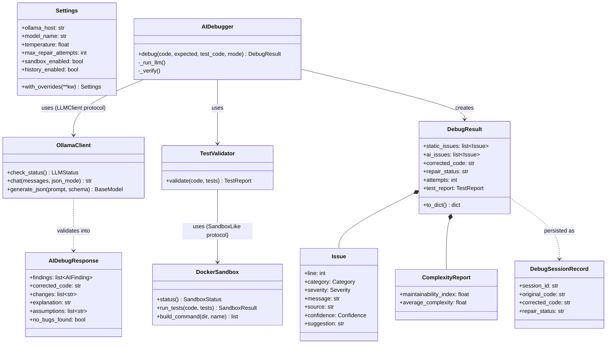
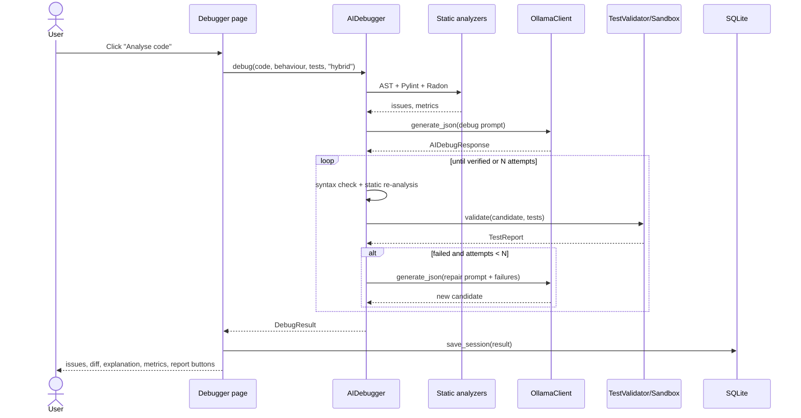
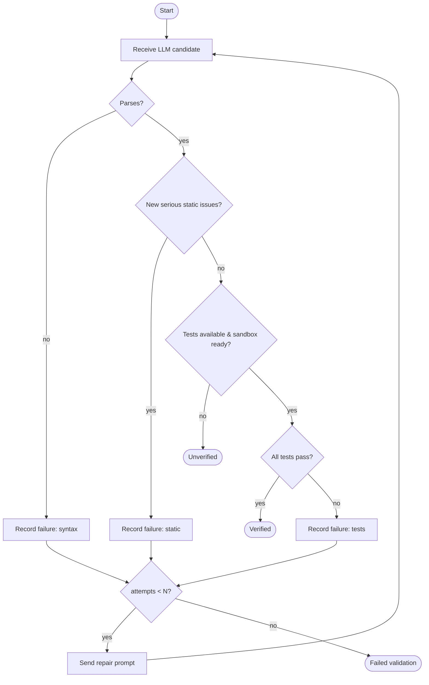
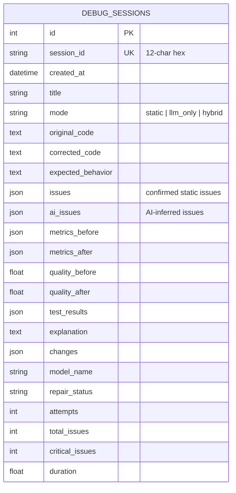

# CodeMind AI – AI-Powered Python Code Debugger and Optimization System

**B.Tech Final-Year Major Project Report** · Department of [Artificial Intelligence and Machine Learning] · [College] · [Year]
Submitted by: [Your name] ([Roll No.]) · Under the guidance of: [Guide name]

> Sections marked **[PENDING]** depend on experiments that have not been performed yet. No result in this report is
> estimated or invented; every number comes from `evaluation/results/` or `docs/testing_report.md`.

---

## 1. Abstract
Debugging consumes a large part of software development effort, and learners often cannot map error messages to
root causes. Static analysers are precise but blind to programmer intent, while large language models (LLMs) can
explain and repair code but may produce plausible yet wrong answers. This project presents **CodeMind AI**, an
offline, free, hybrid and self-verifying Python debugging system. It combines abstract-syntax-tree and symbol-table
analysis, Pylint and Radon metrics with a locally hosted coding LLM (Qwen2.5-Coder through Ollama). AI corrections
are validated against a JSON schema, re-parsed, re-analysed statically and, when tests are available, executed in a
hardened Docker sandbox, with at most *N* iterative repair attempts. The system is delivered as a nine-page Streamlit
application with history, analytics and PDF/JSON reporting. A benchmark of 122 original buggy programs with reference
fixes and independent tests was built and verified automatically. On the 92-program evaluation split, the static
baseline achieved precision 1.000, recall 0.380, F1 0.551 and a false-positive rate of 0.000, detecting none of the
logical errors. Evaluation of the LLM-only and hybrid methods is pending **[PENDING]**.

**Keywords:** automated debugging, program repair, large language models, static analysis, Python, Ollama, sandboxing.

## 2. Introduction
Python is the most common first language in many curricula and the main language for AI/ML work. Typical student
bugs – misspelled names, missing imports, off-by-one loops, wrong operators, unhandled edge cases – are simple for an
expert but time-consuming for a learner. Tools fall into two families. *Static analysers* such as Pylint inspect code
without running it and report rule violations precisely, but they cannot know what the program is *supposed* to do.
*LLM assistants* understand natural language intent and can rewrite code, but they can hallucinate bugs, silently
change behaviour, or return malformed output. CodeMind AI is designed around the idea that each family should do what
it is good at, and that the LLM's output should be **checked** rather than trusted.

## 3. Problem statement
Design and implement a system that, for a given Python program and an optional description of intended behaviour,
(i) detects and explains errors with line numbers, (ii) produces corrected code, (iii) analyses quality and suggests
optimisations, and (iv) validates corrections with tests, while running offline on 8–16 GB RAM without a GPU, using
only free software, and never executing untrusted code on the host machine.

## 4. Project objectives
1. Deterministic detection of syntax, indentation, undefined-name, import, type, runtime-risk, unreachable-code,
   unused-variable and bad-practice issues.
2. Structured AI correction with explanations, using a local LLM and a validated JSON schema.
3. Self-verification: syntax revalidation, static re-analysis, sandboxed tests, bounded repair.
4. Measured quality metrics and a documented quality score; clearly labelled AI estimates.
5. A professional UI with history, analytics and reports.
6. An honest experimental comparison of static-only, LLM-only and hybrid approaches.

## 5. Literature review
*Verify each reference against the original publication before submission.*

**Automated program repair (APR).** Search-based repair such as GenProg [1] evolves patches validated by a test
suite; the survey by Monperrus [2] organises the field and discusses the "overfitting to tests" problem that also
motivates our held-out tests.

**Benchmarks.** QuixBugs [3] provides 40 small programs with one-line bugs in Python and Java; BugsInPy [4] collects
real bugs from Python projects. SWE-bench [5] evaluates LLMs on real GitHub issues and shows that repository-level
repair is still hard.

**LLMs for code.** Codex/HumanEval [6] established functional-correctness evaluation by executing unit tests.
Qwen2.5-Coder [7] is an open family of code models released in sizes from 0.5B to 32B parameters, which makes
CPU-only local inference feasible for small sizes.

**LLM-based repair and self-correction.** Xia and Zhang [8] showed that pre-trained models can repair bugs without
repair-specific training. Self-Debugging [9] lets a model iteratively refine code using execution feedback – the
closest idea to our repair loop. Our contribution is not the loop itself but its packaging with deterministic
analysis, a security-hardened sandbox and held-out evaluation in a small offline tool.

**Software metrics.** Cyclomatic complexity (McCabe [10]), Halstead metrics [11] and the maintainability index
(Oman and Hagemeister [12]) are computed with Radon.

**Security of LLM-integrated applications.** Indirect prompt injection [13] shows that content processed by an LLM
can carry instructions; we therefore treat code and comments as untrusted data.

## 6. Existing system
- **IDE linters (Pylint, Flake8, Pyright):** precise, fast, offline; no intent awareness, no fixes for logical errors.
- **Online AI assistants (chat-based):** good explanations; need internet and often paid accounts; send code to third
  parties; no systematic verification; may change behaviour silently.
- **Classical APR research tools:** require test suites and are not designed for learners.

Drawbacks: separation of static and AI tools, no verification of AI output, privacy concerns, cost.

## 7. Proposed system
CodeMind AI integrates analysis, AI repair and verification in one offline application:
- Confirmed (static) and AI-inferred findings are shown separately.
- The LLM receives the confirmed findings and the intended behaviour as context.
- Corrections are verified (schema → syntax → static → sandbox tests) with a bounded repair loop.
- Measurements are deterministic; AI estimates are labelled.
- If Ollama or Docker is missing the system degrades gracefully.

## 8. Feasibility study
- **Technical:** all components are mature open-source projects; small coding models run on CPU.
- **Economic:** zero licence cost; no API fees; runs on existing student laptops.
- **Operational:** browser UI; one command to start; beginner installation guide.
- **Legal/ethical:** MIT licence; code stays local; QuixBugs is MIT-licensed; AI output is labelled as such.
- **Schedule:** phased plan (Section 25) fits a semester for one student.

## 9. Software requirements specification
See [SRS.md](SRS.md) for the complete SRS. Summary below.

## 10. Functional requirements
FR-01 … FR-22 in [SRS.md](SRS.md): code input/upload/samples; detection with line, category, severity, confidence;
structured AI correction; schema validation and fallback; revalidation; sandboxed tests and bounded repair; diff with
copy/download; metrics and quality score; optimisation suggestions; test generation and editing; AI assistant;
history with search/filter/delete and an off switch; PDF/JSON reports; analytics; settings; benchmark script.

## 11. Non-functional requirements
Security (no host execution, sandbox restrictions, prompt-injection mitigation), privacy (local only, no telemetry),
performance (static analysis well under 5 s; measured mean 0.29 s per benchmark program), reliability (graceful
degradation), usability (dark accessible theme, status indicators), portability (Windows/macOS/Linux),
maintainability (layered modules, type hints, 86 automated tests), honesty (no overclaiming).

## 12. Hardware and software requirements
| | Minimum | Recommended |
|---|---|---|
| CPU / RAM | 4 cores / 8 GB | 8 cores / 16 GB |
| GPU | not required | optional |
| Disk | 5 GB | 10 GB |
| Software | Python 3.11+, browser | Ollama, Docker, VS Code |

## 13. System architecture


The layers are separated so that the UI (`views/`) never contains business logic, the core (`core/`) has no UI
imports and is reused by the benchmark, and external systems (Ollama, Docker) sit behind protocols that tests replace
with doubles.

## 14. Data flow diagram – Level 0


## 15. Data flow diagram – Level 1


## 16. UML use case diagram


## 17. UML class diagram


## 18. Sequence diagram


## 19. Activity diagram


## 20. ER diagram


## 21. Database schema
| Column | Type | Notes |
|---|---|---|
| id | INTEGER PK | autoincrement |
| session_id | VARCHAR(32) UNIQUE | 12-char hex |
| created_at | DATETIME | indexed |
| title | VARCHAR(200) | first `def`/`class` line |
| mode | VARCHAR(20) | static / llm_only / hybrid |
| original_code, corrected_code, expected_behavior, explanation | TEXT | |
| issues, ai_issues, changes | JSON | lists of issue dicts / strings |
| metrics_before, metrics_after, test_results | JSON | Radon metrics; test report |
| quality_before, quality_after | FLOAT | quality score |
| model_name | VARCHAR(100) | |
| repair_status | VARCHAR(40) | indexed |
| attempts, total_issues, critical_issues | INTEGER | |
| duration | FLOAT | seconds |

## 22. Methodology
Summarised here; full details in [methodology.md](methodology.md).
1. **Input validation** – size/line limits, UTF-8, no NUL bytes.
2. **Static analysis** – AST/symtable checks and Pylint (subprocess, temp dir, timeout); merged by line and category.
3. **Metrics** – Radon; quality = 0.7 · issue score + 0.3 · MI, capped at 20 for syntax errors.
4. **Prompting** – line-numbered code inside untrusted-data delimiters, confirmed findings, intended behaviour,
   JSON schema; temperature 0.1.
5. **Inference & validation** – Ollama JSON mode, tolerant extraction, Pydantic coercion, bounded re-asks.
6. **Verification & repair** – Algorithm 1 (Section 24).
7. **Evaluation** – 122-program dataset, dev/eval split, validation vs held-out tests, three methods.

## 23. Module descriptions
| Module | Description |
|---|---|
| Code editor & input | Ace editor with line numbers and issue markers; upload; samples; intended behaviour |
| Syntax checker | Parsing errors; symtable scope analysis; pattern visitor |
| Static analyzer | Pylint integration and merge |
| Complexity analyzer | Radon metrics; quality score; grade |
| LLM engine | Ollama client, health check, JSON mode, retries |
| AI debugger | Pipeline modes, repair loop, finding filtering |
| Optimizer | Measured, rule-based and AI suggestions; heuristic Big-O |
| Code comparator | difflib side-by-side and inline highlighting |
| Test generator | LLM test specs, editing, safety filter, pytest rendering |
| Sandbox & validator | Hardened Docker execution; result parsing |
| Database | SQLAlchemy model and CRUD |
| Reports | PDF (ReportLab) and JSON |
| Analytics | Plotly charts for session, history and benchmark |

## 24. Algorithm and pseudocode
**Algorithm 1 – Hybrid self-verifying repair**
```
Input : code C, behaviour B, tests T (optional), limit N
S  ← StaticAnalysis(C)
C* ← LLM(Prompt(C, S, B)).corrected_code or C;  k ← 1
loop
    f ← ∅
    if not Parses(C*)                            then f ← syntax error
    else if Serious(C*) \ Serious(C) ≠ ∅          then f ← new static errors
    else if T and SandboxReady                    then f ← failures of Sandbox(C*, T)
    if f = ∅ or k = N then break
    k ← k + 1;  C* ← LLM(RepairPrompt(C, C*, f, B)).corrected_code or C*
return C*, Status(C*, f, tests)
```

**Algorithm 2 – Undefined-name detection with symtable**
```
M ← names assigned/imported at module level ∪ names declared global and assigned anywhere
for each scope s in symtable(C):
    for each symbol x in s referenced:
        if (s is module and x not assigned/imported) or (s is function and x is global):
            if x ∉ M and x ∉ builtins:
                report MissingImport(x) if x is a known module/alias else UndefinedName(x)
```

## 25. Implementation
Implemented in Python 3.11+ following the ten-phase plan in [IMPLEMENTATION_PLAN.md](IMPLEMENTATION_PLAN.md).
Highlights:
- `core/syntax_checker.py` (~380 lines) – no execution of user code; symtable for scopes.
- `core/llm_engine.py` – raw HTTP to Ollama, `format: "json"`, `num_ctx`, timeout, exponential backoff.
- `core/ai_debugger.py` – one class implements all three evaluated methods.
- `core/sandbox.py` – `docker run --network none --user 65534:65534 --read-only --cap-drop ALL …`.
- `views/` – nine pages with `st.navigation`, custom CSS, Plotly charts, `streamlit-ace` editor.
Screenshots are in `screenshots/` (taken with the mock LLM server; replace with real-model screenshots).

## 26. Testing and validation
86 automated tests (unit, integration with scripted LLM/fake sandbox, and 4 real Docker tests) pass on Python 3.13;
73 non-Docker tests pass on Python 3.11. A Playwright end-to-end run clicked through all pages and the
debug → test → verified → PDF flow. Details, environments and bugs fixed: [testing_report.md](testing_report.md).

## 27. Experimental results
**Setup.** Eval split: 92 buggy programs + their 92 reference fixes (label 0). Python 3.13, Pylint enabled,
2026-11-25. Run with `python run_benchmark.py`.

| Method | Accuracy | Precision | Recall | F1 | FPR | Localisation | Repair rate | Test pass rate | Time (s) |
|---|---|---|---|---|---|---|---|---|---|
| Static (B1) | 0.690 | 1.000 | 0.380 | 0.551 | 0.000 | 0.359 | n/a | n/a | 0.29 |
| LLM only (B2) | [PENDING] | | | | | | | | |
| Hybrid (proposed) | [PENDING] | | | | | | | | |

**Static recall by category (measured):** syntax 1.00 (8), missing import 1.00 (6), unused variable 1.00 (3),
undefined variable 0.875 (8), unreachable 0.75 (4), indentation 0.67 (6), bad practice 0.29 (7), runtime 0.20 (10),
type 0.00 (8), logical 0.00 (32).

**Discussion of measured results.** Static analysis is precise on this dataset but finds only structural bugs; all
32 logical errors and all 8 type errors in the eval split were missed. Indentation bugs that still parse (e.g.
`return` inside a loop) are logical in effect and are also missed. This gap is exactly what the LLM is expected to
fill; whether the hybrid method fills it without adding false positives is the main open question **[PENDING]**.
Precision of 1.0 should not be generalised: the clean programs are short reference solutions.

## 28. Limitations
- Small local models can miss bugs, hallucinate, or be slow on CPU.
- Static analysis does not understand intent; logical errors need a behaviour description or tests.
- Tests show behaviour only for the tested inputs; they do not prove correctness.
- The dataset is small, synthetic, single-function and written by the project author.
- The heuristic Big-O and AI complexity statements are estimates.
- Docker is required for execution; on Windows it needs Docker Desktop with WSL 2.
- Single-file analysis only; no multi-module projects.

## 29. Future scope
Run and report the LLM experiments with several model sizes; evaluate on QuixBugs and a BugsInPy subset; add
multi-file project support; a VS Code extension; type inference with mypy/pyright; property-based test generation
(Hypothesis); retrieval of similar past fixes from history; fine-tuning a small model on the dev split; support for
more languages; classroom mode with anonymised analytics.

## 30. Conclusion
CodeMind AI demonstrates that a useful, verifiable AI debugging assistant can be built from free components and run
offline on an ordinary laptop. The system separates confirmed from AI-inferred findings, checks every AI correction,
and executes code only in a hardened sandbox. The benchmark infrastructure is complete and verified, and the first
measurement shows the limits of static analysis on logical bugs. Completing the LLM experiments will show to what
extent the hybrid self-verifying design closes that gap.

## 31. References
[1] C. Le Goues, T. Nguyen, S. Forrest, W. Weimer, "GenProg: A Generic Method for Automatic Software Repair," *IEEE
Transactions on Software Engineering*, vol. 38, no. 1, pp. 54–72, 2012.
[2] M. Monperrus, "Automatic Software Repair: A Bibliography," *ACM Computing Surveys*, vol. 51, no. 1, 2018.
[3] D. Lin, J. Koppel, A. Chen, A. Solar-Lezama, "QuixBugs: A Multi-Lingual Program Repair Benchmark Set Based on the
Quixey Challenge," in *Proc. SPLASH Companion*, 2017.
[4] R. Widyasari et al., "BugsInPy: A Database of Existing Bugs in Python Programs to Enable Controlled Testing and
Debugging Studies," in *Proc. ESEC/FSE*, 2020.
[5] C. E. Jimenez et al., "SWE-bench: Can Language Models Resolve Real-World GitHub Issues?," in *Proc. ICLR*, 2024.
[6] M. Chen et al., "Evaluating Large Language Models Trained on Code," arXiv:2107.03374, 2021.
[7] B. Hui et al., "Qwen2.5-Coder Technical Report," arXiv:2409.12186, 2024.
[8] C. S. Xia, L. Zhang, "Less Training, More Repairing Please: Revisiting Automated Program Repair via Zero-Shot
Learning," in *Proc. ESEC/FSE*, 2022.
[9] X. Chen, M. Lin, N. Schärli, D. Zhou, "Teaching Large Language Models to Self-Debug," arXiv:2304.05128, 2023.
[10] T. J. McCabe, "A Complexity Measure," *IEEE Transactions on Software Engineering*, vol. SE-2, no. 4, 1976.
[11] M. H. Halstead, *Elements of Software Science*. New York: Elsevier, 1977.
[12] P. Oman, J. Hagemeister, "Metrics for Assessing a Software System's Maintainability," in *Proc. ICSM*, 1992.
[13] K. Greshake et al., "Not What You've Signed Up For: Compromising Real-World LLM-Integrated Applications with
Indirect Prompt Injection," in *Proc. ACM AISec Workshop*, 2023.
[14] Software: Pylint (pylint.readthedocs.io), Radon (radon.readthedocs.io), Ollama (ollama.com), Streamlit
(streamlit.io), Docker (docs.docker.com), SQLAlchemy, Pydantic, ReportLab, Plotly, scikit-learn.
