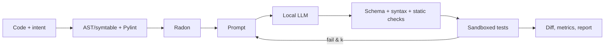

# CodeMind AI: A Lightweight Hybrid Self-Verifying Framework for Offline Python Debugging with Local Language Models

*IEEE conference-style draft.* [Author name], Department of [AI & ML], [College], [City, Country] · [email]

> **Status of this draft:** Sections I–IV and the static-baseline results are complete. Results for the LLM-only
> and hybrid methods are marked **[PENDING]** and must be filled in from `evaluation/results/` after running the
> benchmark with Ollama. Do not submit with placeholders. Verify all references.

---

**Abstract—** Static analysers detect structural defects precisely but cannot reason about programmer intent, while
large language models (LLMs) can repair intent-level bugs but produce unverified and sometimes incorrect output. We
present CodeMind AI, an offline debugging framework for Python that combines abstract-syntax-tree and symbol-table
analysis, Pylint and Radon with a locally hosted coding LLM, and verifies each proposed correction through schema
validation, syntax revalidation, static re-analysis and test execution in a network-isolated, non-root container,
followed by at most *N* repair iterations. We release a benchmark of 122 single-function Python programs with one
bug each, reference fixes and automatically verified tests, split into development and evaluation sets with separate
validation and held-out tests to prevent leakage. On the 92-program evaluation split, the static baseline achieves
precision 1.000, recall 0.380 and F1 0.551, detecting no logical errors. Results for a standalone LLM and the hybrid
method are [PENDING].

**Index Terms—** automated program repair, static analysis, large language models, software testing, Python.

## I. Introduction
Debugging is a core programming skill and a major cost in software development. Novice programmers in particular
face bugs that are simple in hindsight – a misspelled variable, a missing import, an off-by-one loop bound – but hard
to locate. Two families of tools address this. Rule-based static analysers such as Pylint inspect code without
running it and are precise, but they have no notion of what the code *should* do. Code-capable LLMs can explain and
rewrite programs from natural-language intent, but their output can be syntactically invalid, can introduce new
defects, or can "fix" non-existent bugs.

This paper asks: **can a small, locally hosted LLM, constrained by deterministic analysis and verified by isolated
test execution, debug student-scale Python programs more effectively than either component alone?**

Contributions:
1. An open-source, offline system integrating static analysis, a local LLM, and a hardened sandbox in a bounded
   self-verifying repair loop, usable on 8–16 GB laptops without a GPU.
2. A design that separates *confirmed* from *AI-inferred* findings throughout the user interface and reports.
3. A verified benchmark of 122 programs across ten bug categories with leakage controls (dev/eval split;
   validation vs held-out tests).
4. A reproducible three-way evaluation protocol (static, LLM-only, hybrid) sharing one implementation.

We do not claim novelty for iterative repair with execution feedback, which has been studied before [9]; our focus
is an integrated, verifiable and resource-light implementation and an honest evaluation.

## II. Related Work
*Automated program repair.* GenProg [1] searches for patches validated by tests; Monperrus [2] surveys the field
and the risk of patches overfitting to test suites. *Benchmarks.* QuixBugs [3] contains 40 small programs with
single-line bugs; BugsInPy [4] provides real Python project bugs; SWE-bench [5] evaluates repository-level issue
resolution by LLMs. *Code LLMs.* Chen et al. [6] introduced execution-based functional-correctness evaluation;
Qwen2.5-Coder [7] provides open models small enough for CPU inference. *LLM-based repair.* Xia and Zhang [8] showed
zero-shot repair with pre-trained models; Chen et al. [9] proposed self-debugging using execution feedback.
*Security.* Greshake et al. [13] demonstrated indirect prompt injection, motivating our treatment of code and
comments as untrusted data.

## III. System Design
*A. Architecture.* The system has a Streamlit presentation layer, a core logic layer, an LLM client for Ollama, a
Docker sandbox, and SQLite storage (Fig. 1).

*Fig. 1. Hybrid self-verifying pipeline.*

*B. Static analysis.* Parsing errors are reported as critical. Python's `symtable` resolves scopes to detect
undefined names; names matching standard-library modules or common aliases are reported as missing imports. An AST
visitor flags unreachable statements, mutable defaults, bare/silent exceptions, `None`/boolean comparisons,
literal division by zero, string–number literal addition and shadowed builtins. Pylint findings are mapped to the same
taxonomy and merged by (line, category), keeping the higher severity.

*C. Prompting and inference.* The prompt contains line-numbered code inside explicit untrusted-data delimiters, the
confirmed findings, the intended behaviour, and a JSON schema; the system prompt forbids inventing bugs and requires
interface preservation. Ollama is queried in JSON mode at temperature 0.1. Replies are parsed tolerantly and validated
with Pydantic; findings referring to non-existent lines are discarded.

*D. Verification and repair.* A candidate must (i) parse, (ii) introduce no new serious static issues, and (iii) pass
the available tests in the sandbox. Otherwise, the failure description is fed back in a repair prompt, up to *N*
attempts (default 3).

*E. Isolation.* Tests run with pytest inside a container with no network, user 65534, CPU/memory/PID limits,
read-only root filesystem, a small non-executable tmpfs, all capabilities dropped, `no-new-privileges`, a read-only
mount of a temporary directory, an in-process alarm, a host timeout and output truncation. Four integration tests
confirm network blocking, non-root execution, read-only mounts and termination of infinite loops.

## IV. Experimental Setup
*Dataset.* 122 original programs (Table I) with a reference fix, intended behaviour, explanation and 2–5 test calls.
Expected values are computed from the reference; the builder verifies that each reference passes and each buggy
program fails at least one test. Every fourth example forms the dev split (30), the rest the eval split (92). Tests
are split into validation tests (visible to the repair loop) and held-out tests (scoring only).

*TABLE I. Bug categories (all splits).*

| Category | n | Category | n |
|---|---|---|---|
| Logical | 43 | Bad practice | 9 |
| Runtime risk | 13 | Indentation | 8 |
| Undefined variable | 11 | Missing import | 8 |
| Type | 11 | Unreachable | 5 |
| Syntax | 10 | Unused variable | 4 |

*Methods.* B1 static (AST + Pylint, no repair); B2 LLM-only (single call without static context, no verification);
proposed hybrid (static context + verification with validation tests + up to 3 repairs).

*Metrics.* Each method analyses each buggy program (positive) and its reference (negative). A program is predicted
buggy if a serious static issue or AI finding is reported or the LLM changes the code. We report accuracy, precision,
recall, F1, false-positive rate, localisation accuracy (serious issue within ±1 line of the bug), repair rate (all
held-out tests pass in the sandbox), held-out test pass rate and mean time per program.

*Environment.* Static baseline: Linux, Python 3.13.18, Pylint 4.1, Radon 6.0. LLM runs: [PENDING – model,
quantisation, CPU, RAM, Ollama version].

## V. Results
*TABLE II. Results on the eval split (92 buggy + 92 clean programs).*

| Method | Acc. | Prec. | Rec. | F1 | FPR | Loc. | Repair | Pass rate | Time (s) |
|---|---|---|---|---|---|---|---|---|---|
| B1 Static | 0.690 | 1.000 | 0.380 | 0.551 | 0.000 | 0.359 | – | – | 0.29 |
| B2 LLM-only | [PENDING] | | | | | | | | |
| Hybrid | [PENDING] | | | | | | | | |

*Static recall by category:* syntax 1.00, missing import 1.00, unused variable 1.00, undefined variable 0.875,
unreachable 0.75, indentation 0.67, bad practice 0.29, runtime risk 0.20, type 0.00, logical 0.00.

## VI. Discussion
The static baseline is precise but structurally limited: it found every syntax error and missing import but none of
the 32 logical and 8 type errors in the eval split. Indentation errors that still parse (e.g., a `return` placed inside
a loop) behave as logical errors and were missed. These results define the opportunity for the LLM. The key questions
for the pending experiments are whether the hybrid method (a) raises recall on logical errors, (b) keeps the false-
positive rate low on correct programs, and (c) improves the held-out repair rate relative to B2 thanks to verification
and repair. [PENDING: answer with measured data; include per-category and failure analysis.]

## VII. Threats to Validity
Programs are small, synthetic and written by the author; results may not generalise to real projects. Perfect static
precision partly reflects short, idiomatic reference solutions. Treating any LLM edit as a detection may inflate
LLM recall. LLM results vary with model, quantisation and sampling; we fix temperature at 0.1 and report run metadata.

## VIII. Conclusion
We presented an offline, verifiable debugging framework and a leakage-aware benchmark. The measured static baseline
shows the need for intent-aware repair; the LLM experiments will quantify how much verification-guided repair helps.

## References
[1] C. Le Goues, T. Nguyen, S. Forrest, and W. Weimer, "GenProg: A generic method for automatic software repair,"
*IEEE Trans. Softw. Eng.*, vol. 38, no. 1, pp. 54–72, 2012.
[2] M. Monperrus, "Automatic software repair: A bibliography," *ACM Comput. Surv.*, vol. 51, no. 1, 2018.
[3] D. Lin, J. Koppel, A. Chen, and A. Solar-Lezama, "QuixBugs: A multi-lingual program repair benchmark set based on
the Quixey Challenge," in *Proc. SPLASH Companion*, 2017.
[4] R. Widyasari et al., "BugsInPy: A database of existing bugs in Python programs to enable controlled testing and
debugging studies," in *Proc. ESEC/FSE*, 2020.
[5] C. E. Jimenez et al., "SWE-bench: Can language models resolve real-world GitHub issues?," in *Proc. ICLR*, 2024.
[6] M. Chen et al., "Evaluating large language models trained on code," arXiv:2107.03374, 2021.
[7] B. Hui et al., "Qwen2.5-Coder technical report," arXiv:2409.12186, 2024.
[8] C. S. Xia and L. Zhang, "Less training, more repairing please: Revisiting automated program repair via zero-shot
learning," in *Proc. ESEC/FSE*, 2022.
[9] X. Chen, M. Lin, N. Schärli, and D. Zhou, "Teaching large language models to self-debug," arXiv:2304.05128, 2023.
[10] T. J. McCabe, "A complexity measure," *IEEE Trans. Softw. Eng.*, vol. SE-2, no. 4, 1976.
[11] M. H. Halstead, *Elements of Software Science*. Elsevier, 1977.
[12] P. Oman and J. Hagemeister, "Metrics for assessing a software system's maintainability," in *Proc. ICSM*, 1992.
[13] K. Greshake et al., "Not what you've signed up for: Compromising real-world LLM-integrated applications with
indirect prompt injection," in *Proc. ACM AISec*, 2023.
